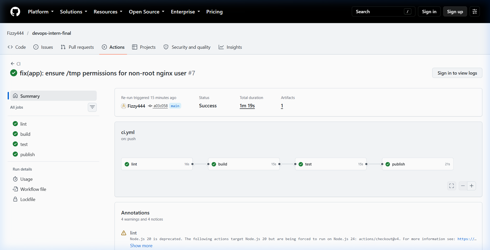

# DevOps Intern Final Assessment

[](https://github.com/Fizzy444/devops-intern-final/actions/workflows/ci.yml)

**Name:** Mithun
**Submission date:** 2026-10-23
**Release tag:** v1.0.0

## Architecture

```
 developer ──push/PR──> GitHub ──> GitHub Actions CI ──────────────┐
                                   lint -> build -> test -> publish │
                                                                    v
                                                      ghcr.io/<user>/devops-intern-final:<sha>
                                                                    │
                                                          nomad job run (tag variable)
                                                                    v
                         Consul <── service + /healthz check ── Nomad alloc (nginx:1.27-alpine, port 8080)
                                                                    │ container stdout (JSON access logs)
                                                                    v
                                                  Promtail (Docker SD) ──> Loki ──> Grafana Explore
```

Each stage consumes the output of the previous one: the CI-built image is the one pushed to GHCR, the Nomad job pulls that exact SHA tag, and Promtail ships the logs of the container Nomad started.

## Prerequisites

| Tool | Version |
|---|---|
| Docker Engine | 27.x |
| Docker Compose plugin | 2.29 or newer (2.23.1 minimum) |
| Nomad | 1.9.x |
| Consul | 1.20.x |
| ShellCheck | 0.10.0 |
| curl | 8.x |

## Quick Start

```sh
git clone https://github.com/Fizzy444/devops-intern-final.git && cd devops-intern-final
docker build -t devops-intern-final:local --build-arg BUILD_SHA="$(git rev-parse --short HEAD)" --build-arg BUILD_DATE="$(date -u +%F)" app
docker run -d --name web -p 8080:8080 --label logging=promtail --label service=nginx-app devops-intern-final:local
scripts/healthcheck.sh
curl -i http://localhost:8080/
```

Optional log stack: `docker compose -f monitoring/docker-compose.yaml up -d`

## Repository layout

```
app/          Dockerfile, nginx.conf, index.html
scripts/      sysinfo.sh, healthcheck.sh
.github/      CI workflow
nomad/        Nomad job specification
monitoring/   Loki, Promtail, Grafana stack and loki_setup.md
docs/         Screenshots
```

## Task 1: Source control

Work was done on `feature/*` branches and merged into `main` through pull requests, using conventional commit messages. The final state is tagged `v1.0.0`.

```sh
git log --oneline --graph
git tag -l
```

Pull requests: add links here.

## Task 2: Linux scripting

Both scripts use a `bash` shebang because `pipefail` is required by the brief and is not part of POSIX `sh`. Apart from that they stick to POSIX constructs. Both are marked executable in Git:

```sh
git update-index --chmod=+x scripts/sysinfo.sh scripts/healthcheck.sh
git ls-files -s scripts
shellcheck scripts/*.sh
```

Run them:

```sh
scripts/sysinfo.sh
scripts/healthcheck.sh
scripts/healthcheck.sh http://localhost:8080/does-not-exist; echo "exit=$?"
```

Observed output:

```
PASTE_OUTPUT_HERE
```

`healthcheck.sh` exits 0 on HTTP 200, 1 on any other status or an unreachable host, and 2 if curl is missing.

## Task 3: Containerisation

```sh
docker build -t devops-intern-final:local --build-arg BUILD_SHA="$(git rev-parse --short HEAD)" --build-arg BUILD_DATE="$(date -u +%F)" app
docker run -d --name web -p 8080:8080 devops-intern-final:local
docker images devops-intern-final:local
curl -i http://localhost:8080/
curl -i http://localhost:8080/healthz
docker exec web id
docker inspect --format '{{.State.Health.Status}}' web
```

Design decisions: pinned base `nginx:1.27-alpine`, non-root `USER nginx`, PID file and temp paths moved to `/tmp`, port 8080 so no privileged bind is needed, `BUILD_SHA` injected into both `index.html` and an `X-Build-SHA` response header, JSON access logs on stdout for Loki.

Observed output:

```
PASTE_OUTPUT_HERE
```

Image size must be under 60 MB: record the `docker images` result above.

## Task 4: Continuous integration

`.github/workflows/ci.yml` runs on push and pull request to `main` with four jobs:

| Job | What it does |
|---|---|
| lint | `shellcheck scripts/*.sh` and hadolint on `app/Dockerfile` |
| build | Builds with `BUILD_SHA=${{ github.sha }}`, saves the image as an artifact |
| test | Loads that image, waits for the container healthcheck, runs `scripts/healthcheck.sh`, fails the job otherwise |
| publish | Push to `main` only, pushes the tested image to GHCR tagged with the commit SHA and `latest` |

Security: workflow-wide `contents: read`, `packages: write` only on the publish job, authentication with `GITHUB_TOKEN`, actions pinned to major versions, no stored credentials.

After the first run, set the GHCR package visibility to public so Nomad can pull it without credentials (Package settings, Change visibility).

Evidence: add a screenshot of the green run and the package page.



## Task 5: Nomad orchestration

Replace `Fizzy444` in `nomad/nginx-app.nomad.hcl` (or pass `-var image_repo=...`), then start local agents and deploy a published SHA tag:

```sh
consul agent -dev
sudo nomad agent -dev
export NOMAD_ADDR=http://127.0.0.1:4646
TAG=<commit-sha-from-GHCR>
nomad job validate -var image_tag=$TAG nomad/nginx-app.nomad.hcl
nomad job plan -var image_tag=$TAG nomad/nginx-app.nomad.hcl
nomad job run -var image_tag=$TAG nomad/nginx-app.nomad.hcl
nomad job status nginx-app
```

Observed output:

```
PASTE_OUTPUT_HERE
```

Resources are the requested 100 MHz CPU and 64 MB memory with no deviation. `image_tag` has no default on purpose so that `latest` is never the only deployment tag.

The update stanza does rolling deploys with `max_parallel = 1`, `min_healthy_time = 10s`, `healthy_deadline = 2m` and `auto_revert = true`. Restart is 3 attempts per 5 minutes, then rescheduling with exponential backoff.

## Task 6: Log aggregation with Loki

```sh
docker compose -f monitoring/docker-compose.yaml up -d
curl -s -o /dev/null http://localhost:8080/does-not-exist
```

Then in Grafana Explore (http://localhost:3000) run `{job="nginx-app"} | json | status != "200"`.

Full details, label set, queries, results and problems are in [monitoring/loki_setup.md](monitoring/loki_setup.md).


## Troubleshooting

Replace these with failures you actually hit while building this. Likely candidates:

1. **nginx: `mkdir() "/var/cache/nginx/client_temp" failed (13: Permission denied)` as non-root.** Fixed by pointing every `*_temp_path` and the `pid` file at `/tmp` in `nginx.conf`.
2. **Nomad cannot pull the image (`unauthorized`).** The GHCR package was private by default. Made it public.
3. **`nomad job validate` complains about a missing `image_tag`.** The variable has no default, pass it with `-var image_tag=<sha>`.

## Known limitations

- Single Nomad node, `count = 1`, so there is no real high availability.
- No TLS in front of the application.
- Grafana runs with anonymous Admin access, acceptable for a local lab only.
- Loki uses local filesystem storage with 7 day retention and no backups.
- Promtail depends on the Docker socket, which is a privileged mount.
- Images are not scanned for vulnerabilities and not signed.
- With more time: add Trivy scanning, cosign signing, a Consul-aware reverse proxy with TLS, and Prometheus metrics.
