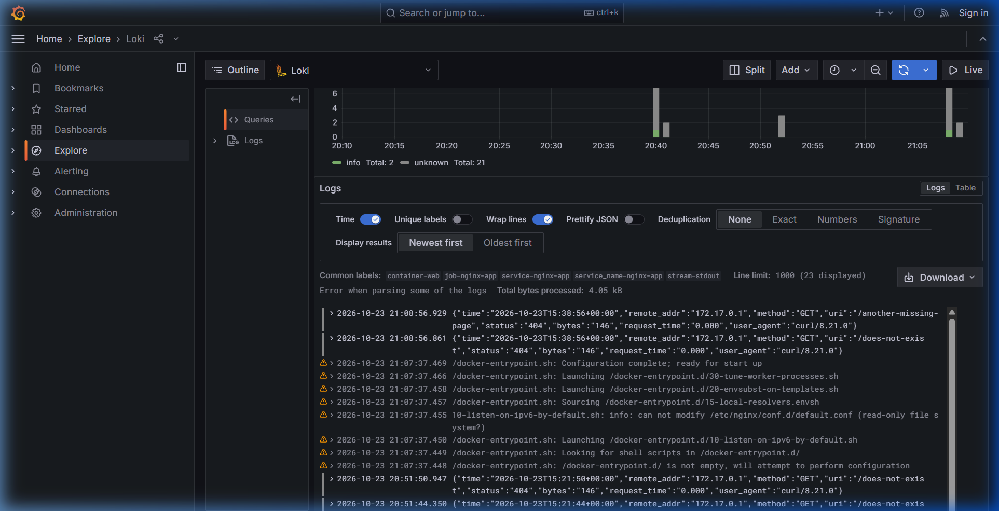

# Loki Log Aggregation Setup

## 1. Start the stack

```sh
docker run -d --name web -p 8080:8080 --label logging=promtail --label service=nginx-app devops-intern-final:local
cd monitoring
docker compose up -d
docker compose ps
curl -s http://localhost:3100/ready
```

Expected: `loki`, `promtail` and `grafana` are `running`, and `/ready` returns `ready`.

When the application runs under Nomad, the job file already sets the `logging=promtail` and `service=nginx-app` Docker labels, so no extra flags are needed.

## 2. Label set

| Label | Source | Purpose |
|---|---|---|
| `job` | static `nginx-app` in `promtail-config.yaml` | Select the whole application |
| `container` | `__meta_docker_container_name` | Identify the container |
| `service` | Docker label `service` | Match the Consul service name |
| `nomad_alloc_id` | Docker label `com.hashicorp.nomad.alloc_id` (set by the Nomad Docker driver) | Trace logs to a Nomad allocation, empty for plain `docker run` |
| `stream` | `__meta_docker_container_log_stream` | Separate stdout (access) and stderr (error) logs |

Only containers carrying the Docker label `logging=promtail` are scraped.

## 3. Generate traffic

```sh
for i in 1 2 3; do curl -s -o /dev/null http://localhost:8080/; done
curl -s -o /dev/null http://localhost:8080/does-not-exist
curl -s -o /dev/null http://localhost:8080/another-missing-page
```

## 4. LogQL queries

Run these in Grafana at http://localhost:3000 under Explore with the Loki data source.

All logs for the application:

```logql
{job="nginx-app", service="nginx-app"}
```

NGINX access logs that are not HTTP 200:

```logql
{job="nginx-app"} | json | status != "200"
```

Count of 404 responses over five minutes:

```logql
sum(count_over_time({job="nginx-app"} | json | status="404" [5m]))
```

Equivalent from the command line:

```sh
curl -G -s http://localhost:3100/loki/api/v1/query_range \
  --data-urlencode 'query={job="nginx-app"} | json | status != "200"'
```

## 5. Results

Paste the observed output of the non-200 query here, and reference the screenshot:

```
PASTE_RESULT_HERE
```



## 6. Problems and resolutions

Replace this table with the problems you actually hit while running the stack. Candidates to check for on your machine:

| Problem | Resolution |
|---|---|
| Promtail logs `permission denied` on `/var/run/docker.sock` | Run Promtail as root as in the compose file, or add the docker group GID with `group_add` |
| Grafana shows no data source | Needs Docker Compose 2.23.1 or newer for inline `configs.content`, otherwise add `http://loki:3100` manually |
| Query returns nothing | Container was started without `--label logging=promtail`, recreate it |
